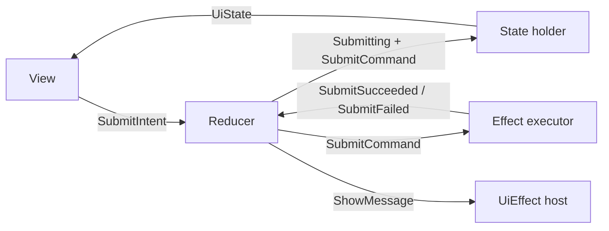
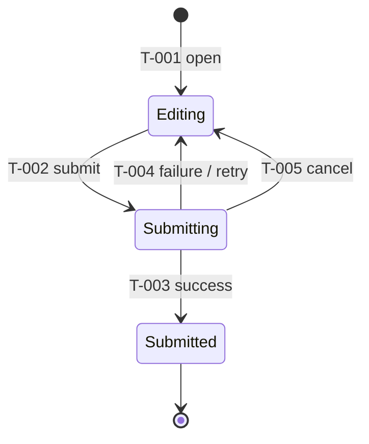
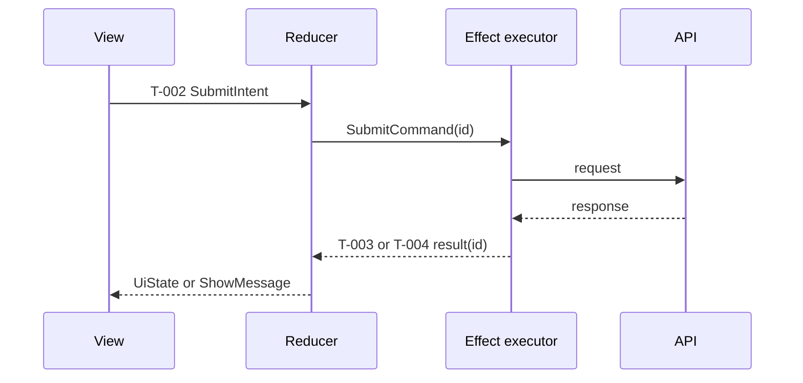

# Generic MVI State-flow Example

This example is a reusable, complete `design.md` shape for a complex state-flow
slice. Adapt its facts and IDs to the current requirement; never copy its sample
behavior as project truth.

> Language boundary: this file is an English source reference. When the user's conversation is in another language, localize every human-readable heading, table header/cell, explanatory sentence, and Mermaid node, edge, or participant label. Keep machine syntax, IDs, code/API/library/protocol names, and required technical tokens unchanged.

## Context and scope

The example models one authenticated submission flow. It excludes account
creation and background synchronization.

<!-- ai-delivery:behavior-contract:start -->
<!-- ai-delivery:behavior-contract:scope -->
## Behavioral boundary

An authenticated user edits, submits, cancels, or retries one draft. The flow
preserves user input on failure and ignores stale results.

<!-- ai-delivery:behavior-contract:behavior -->
## Behavior contract

| Behavior ID | Given | When | Then | Boundary / failure behavior |
|-------------|-------|------|------|-----------------------------|
| B-001 | A valid editable draft | The user submits it | Exactly one active request owns the visible submitting state | Duplicate input is deduplicated and stale results are ignored |
| B-002 | An active submission | The request fails or is cancelled | The draft returns to editing with its input intact | A one-shot failure effect is emitted only for failure |

<!-- ai-delivery:behavior-contract:acceptance -->
## Acceptance contract

| Acceptance ID | Verifiable outcome | Evidence or command |
|---------------|--------------------|---------------------|
| AC-001 | B-001 keeps only the active correlated result | Focused reducer and command test |
| AC-002 | B-002 preserves input and consumes UiEffect once | Focused projection and restoration test |

<!-- ai-delivery:behavior-contract:traceability -->
## Behavior traceability

| Behavior ID | Requirement source | UI scenario | Acceptance ID |
|-------------|--------------------|-------------|---------------|
| B-001 | REQ-SUBMIT | SC-SUBMIT | AC-001 |
| B-002 | REQ-SUBMIT | SC-FAILURE | AC-002 |
<!-- ai-delivery:behavior-contract:end -->

## Solution design

The state holder owns domain and operation state. A pure projection produces
`UiState`; an effect host consumes one-shot `UiEffect` values. Side effects run
outside the reducer and return correlated result events.

<!-- ai-delivery:state-flow:start -->
<!-- ai-delivery:state-flow:taxonomy -->
## State ownership
| State set | Owner | Source of truth | Lifetime | Persistence / restoration |
|-----------|-------|-----------------|----------|--------------------------|
| Domain state | Store | Repository result | Durable | Restore from repository |
| Operation state | Store | Command lifecycle | Ephemeral | Reset on restore |
| Local input state | View model | User input | Screen | Restore only when specified |
| UiState | Projection | Pure projection | Derived | Never persisted |
| UiEffect | Effect host | Reducer output | One-shot | Never persisted |

<!-- ai-delivery:state-flow:mvi-loop -->
## MVI loop

<!-- ai-delivery:state-flow:lifecycle -->
## Lifecycle

<!-- ai-delivery:state-flow:projection -->
## Projection
`UiState = project(DomainState, OperationState, LocalInputState)`

| Projection ID | Conditions | Visible UI | Interaction |
|---------------|------------|------------|-------------|
| P-001 | Editing + valid input | Enabled submit | Edit and submit |
| P-002 | Submitting | Progress and locked submit | Cancel |
| P-003 | Editing + failure | Error message and enabled retry | Edit and retry |

<!-- ai-delivery:state-flow:matrix -->
## Transition matrix
| Transition ID | From | Intent / Event | Guard | Decision | To | Command | Result event |
|---------------|------|----------------|-------|----------|----|---------|--------------|
| T-001 | none | Open | authenticated | create draft | Editing | none | none |
| T-002 | Editing | SubmitIntent | valid input | mark submitting | Submitting | SubmitCommand(id) | SubmitSucceeded / SubmitFailed |
| T-003 | Submitting | SubmitSucceeded(id) | id matches active id | commit domain result | Submitted | none | none |
| T-004 | Submitting | SubmitFailed(id) | id matches active id | retain input and expose failure | Editing | none | none |
| T-005 | Submitting | CancelIntent | command cancellable | invalidate active id | Editing | CancelCommand(id) | Cancelled(id) |

<!-- ai-delivery:state-flow:sequences -->
## Async sequence

<!-- ai-delivery:state-flow:invariants -->
## Invariants
<!-- ai-delivery:state-flow:stale-result -->
- A result with a non-active correlation ID is ignored as stale.
<!-- ai-delivery:state-flow:concurrency -->
- Concurrent submits use the request ID as a deduplication key; the active request wins.
- Submit is idempotent for the same request ID.
- Failure does not erase user input.
- UiEffect is consumed once and is not reconstructed from restored UiState.

<!-- ai-delivery:state-flow:traceability -->
## Traceability
| ID | Requirement | Scenario | Test |
|----|-------------|----------|------|
| T-002 / P-002 | REQ-SUBMIT | SC-SUBMIT | test/submit_test.dart |
<!-- ai-delivery:state-flow:end -->

<!-- ai-delivery:user-decisions -->
## User decisions

`not_applicable`: governed evidence fully determines the example behavior; no
material product, resource, or experience choice remains for the user.

## Risks and verification

- Verify duplicate submit, cancellation, stale success, stale failure,
  restoration, and single-consumption effect paths.
- Verify that the reducer remains pure and that restored state never replays a
  historical `UiEffect`.
